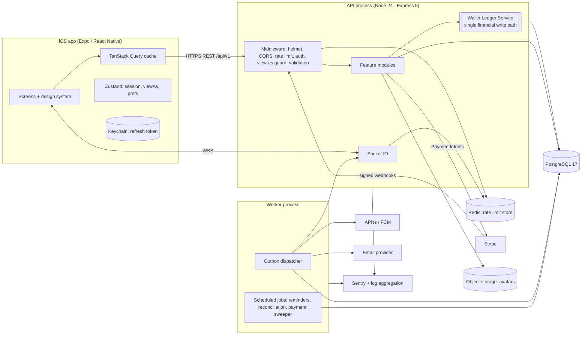
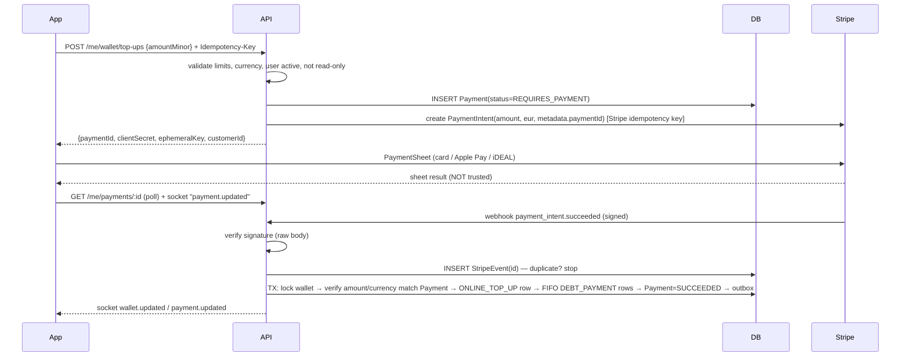
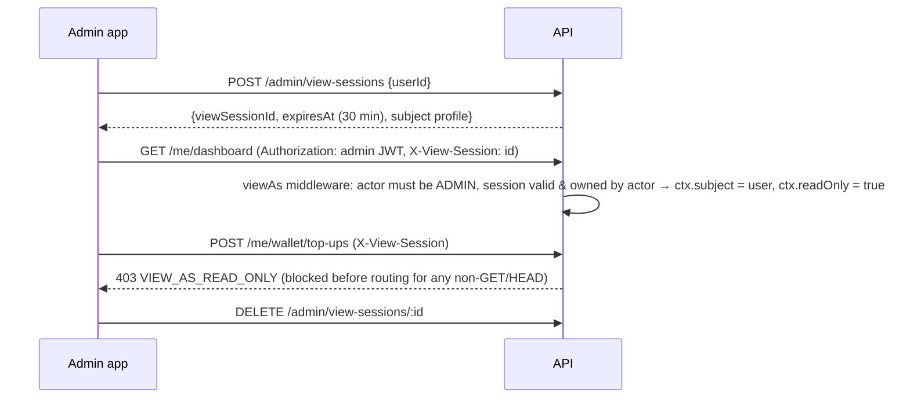

# 02 — System Architecture

Status: **Draft for approval** · 2026-11-24

---

## 1. Overview



### Architectural style: modular monolith
One deployable backend codebase with **two process types**: `api` (HTTP + WebSocket) and `worker` (background jobs).

- **Why not microservices:** the domain is small and highly transactional. Wallet, charges, attendance and debt must change atomically in **one** Postgres transaction. Splitting services would turn that into distributed transactions or sagas, adding risk and no benefit.
- **Why modules:** each feature module owns its routes, validation, service and data access. Modules talk to each other through service interfaces, never through one another's tables. This keeps a later extraction possible, e.g. notifications as its own service.
- **Scaling:** the `api` process is stateless and scales horizontally behind a load balancer. Redis is the shared rate-limit store. Realtime events fan out to every instance through Postgres LISTEN/NOTIFY (ADR 0007). The `worker` uses `SKIP LOCKED` row claiming, so several instances are safe.

---

## 2. Backend architecture

### 2.1 Layers (per module)
```
routes      → declares endpoints, attaches auth/RBAC/validation/idempotency middleware
controller  → maps HTTP ⇄ service call; no business rules
service     → business rules, transactions, authorization of *data* (ownership)
repository  → Prisma queries only (and audited raw SQL where needed, e.g. FOR UPDATE)
domain      → pure functions (price resolution, debt allocation, reversal math) — 100% unit tested
schemas     → Zod request/response schemas, imported from packages/contracts
```

### 2.2 Request context
Every authenticated request carries:
```ts
type RequestContext = {
  requestId: string;
  actor:   { id: string; role: 'ADMIN' | 'USER' };   // who is authenticated — never replaced
  subject: { id: string };                           // whose data "me" endpoints read
  viewSessionId?: string;                            // set only in View-as mode
  readOnly: boolean;                                 // true in View-as mode
};
```
- For a normal user, `subject = actor`.
- In View-as mode, `subject` is the viewed user and `actor` stays the admin. Services use `subject` to scope data and `actor` for permissions and audit.

### 2.3 The Wallet Ledger Service — the only financial write path
No module may write `wallets`, `wallet_transactions`, `debts`, `debt_settlements` or `training_charges` directly. Every financial operation calls one of:

```ts
ledger.creditOnlineTopUp({ paymentId })                     // from webhook only
ledger.creditCash({ userId, amountMinor, adminId, note, idempotencyKey })
ledger.chargeTraining({ trainingId, userId, attendanceId }) // from finalization only
ledger.reverse({ transactionId, adminId, reason })
ledger.adjust({ userId, walletDeltaMinor | debtWaiverMinor, adminId, reason, idempotencyKey })
ledger.refund({ userId, amountMinor, method, adminId, reason, idempotencyKey })
```

Every call runs this algorithm **inside one DB transaction**:
1. `SELECT … FROM wallets WHERE id = $1 FOR UPDATE`. If several wallets are involved, lock them in ascending `id` order.
2. If a row with this `idempotencyKey` already exists, return it unchanged (replay-safe).
3. Compute the deltas with a **pure domain function**, and assert `balanceAfter ≥ 0` and `debtAfter ≥ 0`.
4. Insert the ledger row with `sequence = wallet.sequence + 1`, plus the before/after balance and debt.
5. Update the wallet's cached `balanceMinor`, `debtMinor` and `sequence`.
6. Insert side records: `TrainingCharge`, `Debt`, `DebtSettlement`.
7. If this was a credit and debt is open, run **FIFO debt settlement** (one `DEBT_PAYMENT` row per settlement), still in the same transaction.
8. Insert `AuditLog` and `OutboxEvent` rows (notifications, socket pushes, low-balance check).
9. Commit. Unique constraints are the last line of defence: a `P2002` error on `idempotencyKey` returns the existing row.

### 2.4 Transactional outbox
Side effects (push, email, socket events) are **never** sent inside the business transaction. Instead an `OutboxEvent` row is committed **atomically** with the business change. The worker claims rows (`FOR UPDATE SKIP LOCKED`), dispatches them, and retries with backoff.
Result: there is never a "notification sent but the charge rolled back" situation, and never a "charge committed but notification lost" one.

Scheduled jobs (training reminders, debt reminders, reconciliation, Stripe payment sweeper, admin "finalize attendance" reminders) run in the worker using **pg-boss**. It is Postgres-backed, so no extra infrastructure is needed.

### 2.5 Key flows

#### Online top-up (Stripe PaymentIntent + webhook)

If the amount or currency from Stripe does not match the `Payment` record, nothing is credited. The payment is flagged `REQUIRES_REVIEW` and admins are alerted.

#### Attendance finalization and training charges
```mermaid
sequenceDiagram
  participant Admin
  participant API
  participant DB
  Admin->>API: POST /admin/trainings/:id/attendance/finalize + Idempotency-Key
  API->>DB: TX begin; SELECT training FOR UPDATE
  API->>API: assert not finalized, not cancelled, no PENDING rows (or explicit flag)
  loop each PRESENT user (ordered by walletId)
    API->>API: price = override ?? userStandingPrice ?? training.default  (snapshot)
    API->>DB: lock wallet → TRAINING_PAYMENT row (walletΔ = −min(balance, price), debtΔ = shortfall) → TrainingCharge → Debt (if shortfall)
  end
  API->>DB: training.attendanceFinalizedAt = now(); outbox notifications; audit
  API->>DB: COMMIT
```
All charges for a session commit together or not at all. A partial unique index on `training_charges (training_id, user_id) WHERE status = 'ACTIVE'` makes a double charge impossible.

#### View as User

- The guard is global and default-deny: in view mode **every** method except `GET`/`HEAD` is rejected, whatever route it targets.
- View sessions and all reads in them are written to `AuditLog`.
- Sensitive fields (device tokens, Stripe IDs, security data) are never exposed in user-facing endpoints anyway.

---

## 3. Security architecture

| Concern | Design |
|---|---|
| Passwords | **Argon2id** (`argon2` package, OWASP parameters: m=19 MiB, t=2, p=1), with rehash on login when parameters change. Minimum length 10, checked against a breached-password list (k-anonymity API optional). |
| Access token | JWT, **15 min**, signed with EdDSA/ES256 via `jose`. Claims: `sub`, `role`, `sid` (token family). Verified against `kid`, so keys can rotate. |
| Refresh token | 256-bit random, opaque. Only the **SHA-256 hash** is stored. Lifetime 30 days, sliding. **Rotated on every use.** If a revoked token is presented, the whole family is revoked and the user must sign in again. Stored in the **iOS Keychain** (`expo-secure-store`). |
| Session revocation | Logout revokes the family. "Log out everywhere" increments `user.tokenVersion`. The auth middleware checks `status = ACTIVE` and `tokenVersion` on every request (short in-process cache), so deactivation takes effect immediately. |
| Authorization | `requireRole('ADMIN')` on every `/admin/*` router. Ownership is enforced in services: user endpoints only accept `ctx.subject.id`, never a client-supplied user ID. The frontend role is used only for navigation. |
| Validation | Zod on body, query and params. Unknown keys are stripped. Money must be an integer within bounds. |
| SQL injection | Prisma parameterized queries. Raw SQL only through the `$queryRaw` tagged template (parameterized). No `$queryRawUnsafe`. |
| Rate limiting | `express-rate-limit` with a Redis store. Strict limits on `/auth/*` (e.g. login 5/min per IP+email, reset 3/hour), moderate limits on money endpoints, global per-IP limit. |
| Headers / CORS | `helmet`. CORS allow-list per environment (mobile doesn't need CORS; it exists for the future web admin). |
| Idempotency | An `Idempotency-Key` header is **required** on money-moving and finalize endpoints. The response is stored and replayed. The same key with a different body returns `409`. |
| Webhooks | `express.raw()` on the webhook route only, `stripe.webhooks.constructEvent` with the endpoint secret, event-ID dedupe, 5-minute tolerance. |
| Secrets | Loaded only from environment variables (secret manager in production). Validated at startup with Zod; the process refuses to start if a secret is missing. |
| Logging | pino structured logs with a `requestId`. Redaction of `authorization`, `password`, `token`, `clientSecret`, `email` in production logs. |
| Audit | Append-only `audit_logs` for every admin action, financial operation, auth event and view session. |
| Data protection | TLS everywhere. Encrypted storage at rest (managed provider). PII minimised. Account deletion anonymizes PII and keeps the ledger. |

---

## 4. Mobile architecture

### 4.1 Stack choices
- **Expo (latest stable SDK, New Architecture)** with **development builds**, not Expo Go. EAS Build and Submit for iOS. Native modules come in through config plugins.
- **React Navigation** native stacks (`@react-navigation/native-stack`, UIKit-backed) and bottom tabs, so navigation feels native.
- **Server state:** TanStack Query, the single source for API data, with optimistic updates only for non-financial actions (e.g. reservation toggle). Financial data is **never** optimistic. The UI always shows server-confirmed balances.
- **Client state:** Zustand: `sessionStore` (user, role; tokens are in the Keychain), `viewAsStore` (viewSessionId, subject), `preferencesStore` (theme, language; persisted with MMKV/AsyncStorage).
- **Realtime:** Socket.IO client. Events only **invalidate** query keys (`wallet.updated` → `invalidateQueries(['me','wallet'])`); data always comes from REST.
- **Forms:** `react-hook-form` + `zod` resolver, using the same schemas as the API from `packages/contracts`.
- **Lists:** FlashList. **Animation:** Reanimated (used sparingly). **Haptics:** `expo-haptics` on confirmations.

### 4.2 API client
- A typed fetch wrapper (no axios needed). It attaches the access token and `X-View-Session` when in view mode, and `Accept-Language`.
- **Single-flight refresh:** on `401 TOKEN_EXPIRED`, one refresh call runs, queued requests wait for it, then retry. If refresh fails, the session is cleared and the app goes to Login.
- Errors are normalized to `{ code, message, details }`. The UI shows the translated message for `code` (`errors:<CODE>`), not the server's English text.

### 4.3 Navigation tree
```
RootNavigator (decides by session + role)
├── AuthStack
│   Welcome · Login · Register · ForgotPassword · ResetPassword
├── UserTabs                                   (also used in View-as mode)
│   ├── Home            Wallet card · Next training · Debt banner · Recent transactions · Unread notifications
│   ├── Trainings       Upcoming / Past → TrainingDetail (reserve / decline, price, status)
│   ├── Wallet          Balance · Debt · Top-up sheet · Transactions → TransactionDetail
│   ├── Notifications   History, read/unread
│   └── Profile         Profile edit · Language · Notification prefs · Appearance · Security · Delete account
└── AdminTabs
    ├── Dashboard       KPIs · Needs attention (unfinalized trainings, failed payments) · Recent activity · Quick actions
    ├── Users           Search/filter list → UserDetail (profile, wallet, debt, attendance, trainings, payments)
    │                     actions: Add cash payment · Adjustment · Activate/Deactivate · View as user
    ├── Trainings       Calendar/list → TrainingDetail → Edit · Reservations · Price overrides · Attendance → Finalize
    ├── Finance         Wallets · Transactions (filters, reversal) · Financial reports
    └── More            Attendance queue · Settings · Audit log · Language/Appearance · Sign out
```
The 8 required admin sections all exist as dedicated screens. On iPhone they are grouped into 5 tabs, because iOS tab bars hold 5 items comfortably.
**View as User** opens `UserTabs` as a full-screen modal with the subject's data, a persistent top banner ("Viewing as Anna de Vries · Read-only · Exit"), and every mutation control hidden through `useCanMutate()`. The server still enforces read-only on its own.
In view mode, query keys are prefixed with the subject ID. They are removed from the cache when view mode exits.

### 4.4 Design system
- **Tokens** (`shared/theme`): semantic colours (`background`, `surface`, `surfaceElevated`, `textPrimary`, `textSecondary`, `separator`, `accent`, `success`, `warning`, `danger`), each with light and dark values. **One accent colour.** Spacing on a 4-pt scale. Radii 10/14/22. Typography follows the iOS type ramp (Large Title 34, Title 1 28, Title 2 22, Headline 17 semibold, Body 17, Subhead 15, Footnote 13), with the system font and **Dynamic Type** respected. Shadows are subtle and used only on elevated cards.
- **Primitives:** `Screen`, `Text`, `Card`, `Button`, `IconButton`, `ListRow`, `Section`, `TextField`, `SegmentedControl`, `Sheet`, `ConfirmDialog`, `StatusPill`, `MoneyText`, `StatTile`, `Avatar`, `EmptyState`, `Skeleton`, `ViewAsBanner`.
- **Money display:** always `MoneyText` → `Intl.NumberFormat(locale, { style: 'currency', currency })` from integer minor units (`€ 12,50` in nl-NL, `€12.50` in en). Debt is shown in `danger` colour and never as a negative balance.
- **Accessibility:** WCAG AA contrast in both themes, 44-pt hit targets, VoiceOver labels from i18n keys, reduced-motion respected.

### 4.5 Internationalization
- `i18next` + `react-i18next` + `expo-localization`. On first launch the device language is used if supported (`nl*` → `nl`, otherwise `en`). A manual choice is persisted locally **and** on the profile (`preferredLanguage`), so the server sends push notifications in the right language.
- Namespaced JSON in `packages/i18n/locales/{en,nl}/{common,auth,dashboard,wallet,trainings,notifications,admin,errors}.json`. Adding a language means adding a folder plus one entry in `SUPPORTED_LANGUAGES`.
- Lint rule (`eslint-plugin-i18next`, `no-literal-string` in JSX) stops hard-coded UI text. A CI script fails if `nl` is missing keys present in `en`.
- Dates via `Intl.DateTimeFormat` in the training's timezone. Currency via `Intl.NumberFormat`.
- **Notifications:** the server stores `type + params`. Push text is rendered on the server in the user's language from the shared `notifications` namespace. The in-app list renders on the client in the *current* language.

---

## 5. Notifications architecture
- **Device registration:** the app gets a **native APNs token** (`expo-notifications` `getDevicePushTokenAsync`) and posts it to `/me/devices`. Tokens are unique: re-registering moves a token to the current user. They are removed on logout and pruned when APNs answers `410 Unregistered`.
- **Providers** sit behind a `PushProvider` interface: an `ApnsProvider` (HTTP/2, token-based `.p8` auth, sandbox/production per environment) now, and an `FcmProvider` (`firebase-admin`) when Android ships.
- **Pipeline:** domain event → `OutboxEvent` → worker → creates a `Notification` row (unique `dedupeKey`, e.g. `reminder:24h:<trainingId>:<userId>`) → checks preferences and quiet hours → push → `NotificationDelivery` row → socket `notification.created`.
- **Events:** the 11 events from the spec map to a `NotificationType` enum (see Database doc).

---

## 6. Infrastructure and operations

| Concern | Choice |
|---|---|
| Environments | `local` → `staging` → `production`. Separate Stripe (test/live), APNs (sandbox/prod) and databases. Config through env vars validated by Zod (`apps/api/src/config`). |
| Containers | Multi-stage `Dockerfile` (one image; the command picks `api`, `worker` or `migrate`). `infra/docker-compose.yml` for local Postgres, Redis, Stripe CLI webhook forwarder, Mailpit. |
| Migrations | `prisma migrate dev` locally. **`prisma migrate deploy`** runs as a separate one-off release step before rollout, never on app boot. Raw SQL added to migrations for CHECK constraints, partial indexes and immutability triggers. Expand–contract pattern for breaking changes. |
| Logging | pino JSON to stdout, collected by the platform (e.g. CloudWatch / Better Stack / Grafana Loki). `requestId` propagated to the outbox and jobs. |
| Monitoring | Sentry (API, worker, mobile) with release tracking. Health endpoints `/health/live` and `/health/ready` (DB + Redis). Alerts on reconciliation mismatch, webhook failures, outbox backlog, 5xx rate. |
| Backups | Managed Postgres PITR (≥ 7 days) plus daily snapshots kept ≥ 30 days. Restore drill before go-live. |
| CI (GitHub Actions) | Install → typecheck → lint → i18n key check → unit tests → integration tests (Postgres service container) → build Docker image → OpenAPI diff check. Mobile: typecheck, lint, Jest. |
| CD | Main → staging auto-deploy (migrate, then roll out). Tag → production with manual approval. Mobile: EAS Build → TestFlight. EAS Update for JS-only hotfixes (never for changes that need a new native build). |

---

## 7. Technology stack and versions

Exact versions are **pinned in the lockfile during Phase 2**, verified against the then-current stable releases and the Expo SDK's compatibility list. Targets:

| Layer | Choice | Target | Why |
|---|---|---|---|
| Runtime | Node.js | **24 LTS** | Current LTS; native `fetch`, stable test runner support |
| Language | TypeScript | 5.9+ (strict) | `strict`, `noUncheckedIndexedAccess`, `exactOptionalPropertyTypes` |
| Monorepo | pnpm workspaces | 10.x | Shared contracts/i18n without extra tooling (no Turborepo needed yet) |
| Mobile framework | Expo SDK (React Native, New Architecture) | latest stable at setup | Recommended RN framework; EAS builds; Android/Web path |
| Navigation | React Navigation | 7.x | Required by spec; native-stack |
| Server state | TanStack Query | 5.x | Required by spec |
| Client state | Zustand | 5.x | Required by spec |
| i18n | i18next / react-i18next / expo-localization | 25.x / 15.x+ | Required by spec |
| Payments (app) | `@stripe/stripe-react-native` | Expo-SDK-pinned | PaymentSheet: card, Apple Pay, iDEAL |
| Push (app) | `expo-notifications` | Expo-SDK-pinned | Native APNs token, permission flow |
| Secure storage | `expo-secure-store` | Expo-SDK-pinned | Keychain |
| Forms | react-hook-form + @hookform/resolvers | 7.x | Shared Zod schemas |
| Lists / animation | @shopify/flash-list, react-native-reanimated | 2.x / 4.x | Performance |
| HTTP server | Express | **5.x** | Required by spec; async error propagation built in |
| Validation | Zod | 4.x | Shared by API and app; generates OpenAPI |
| OpenAPI | `@asteasolutions/zod-to-openapi` + Swagger UI | latest | Docs generated from the same schemas, so they cannot drift |
| ORM | Prisma | 6.x/7.x (stable at setup) | Required by spec; typed client, migrations |
| Database | PostgreSQL | **17** | Mature; `citext`, partial indexes, CHECK, triggers |
| Realtime | Socket.IO, fan-out via Postgres LISTEN/NOTIFY (ADR 0007) | 4.8.x | Required by spec |
| Auth crypto | `jose`, `argon2` | latest | Standards-compliant JWT; Argon2id |
| Security middleware | helmet, cors, express-rate-limit + rate-limit-redis | latest | Standard, maintained |
| Stripe (server) | `stripe` | latest, **API version pinned in code** | Webhook verification, PaymentIntents |
| Jobs | pg-boss | latest | Cron and retries on Postgres; no extra broker |
| Push (server) | APNs HTTP/2 client (e.g. `@parse/node-apn`), `firebase-admin` later | latest | Direct APNs, no third-party relay |
| Logging / errors | pino, pino-http, @sentry/node, @sentry/react-native | latest | Structured logs, monitoring |
| Backend tests | Vitest, Supertest, Testcontainers (Postgres) | latest | Real Postgres for locking and concurrency tests |
| Mobile tests | Jest (`jest-expo`), React Native Testing Library, MSW | Expo-pinned | Component and flow tests with mocked API |
| E2E (later) | Maestro | latest | Simple iOS simulator flows |

Avoided on purpose: axios (native fetch suffices), a UI kit (our own design system), Redux (Zustand + Query), a message broker (outbox + pg-boss), NestJS (Express required; the module structure gives the same separation).

---

## 8. Project folder structure

```
training-wallet/
├── apps/
│   ├── api/
│   │   ├── prisma/
│   │   │   ├── schema.prisma
│   │   │   ├── migrations/              # incl. raw SQL: CHECKs, partial indexes, ledger triggers
│   │   │   └── seed.ts                  # first admin, demo data (non-prod only)
│   │   ├── src/
│   │   │   ├── main.ts                  # starts HTTP + Socket.IO
│   │   │   ├── worker.ts                # outbox dispatcher + pg-boss jobs
│   │   │   ├── app.ts                   # createApp() — Express factory, used by tests
│   │   │   ├── config/                  # env.ts (Zod), config.ts
│   │   │   ├── core/
│   │   │   │   ├── db/                  # prisma client, withTransaction, lockWallet(s)
│   │   │   │   ├── http/                # response envelope, pagination, sorting, asyncHandler
│   │   │   │   ├── errors/              # AppError, error codes, error middleware
│   │   │   │   ├── auth/                # jwt, authenticate, request context
│   │   │   │   ├── rbac/                # requireRole, policies
│   │   │   │   ├── view-as/             # view session resolution + read-only guard
│   │   │   │   ├── idempotency/         # Idempotency-Key middleware + store
│   │   │   │   ├── audit/               # audit writer
│   │   │   │   ├── outbox/              # enqueue (in tx), dispatcher
│   │   │   │   ├── realtime/            # socket server, auth, rooms, emit helpers
│   │   │   │   ├── security/            # helmet, cors, rate limiters
│   │   │   │   └── logger/
│   │   │   ├── modules/
│   │   │   │   ├── auth/                # register, login, refresh, logout, password reset, verify email
│   │   │   │   ├── users/               # admin user management
│   │   │   │   ├── profiles/            # me/profile, avatar, preferences, account deletion
│   │   │   │   ├── wallets/             # ledger service + domain/ (pure money math)
│   │   │   │   ├── transactions/        # ledger queries, reversals
│   │   │   │   ├── payments/            # Stripe top-ups, payment status, refunds
│   │   │   │   ├── debts/               # debt queries, waivers (via ledger)
│   │   │   │   ├── trainings/           # CRUD, cancel, series
│   │   │   │   ├── pricing/             # overrides, standing prices, price resolution
│   │   │   │   ├── reservations/
│   │   │   │   ├── attendance/          # marking, finalization, corrections
│   │   │   │   ├── notifications/       # in-app, devices, preferences, push dispatch
│   │   │   │   ├── reports/             # dashboard KPIs, financial reports, CSV export
│   │   │   │   ├── admin/               # view sessions, settings, audit log queries
│   │   │   │   └── webhooks/            # stripe webhook
│   │   │   │       # each module: *.routes.ts *.controller.ts *.service.ts *.repository.ts
│   │   │   │       #              domain/*.ts  __tests__/*.test.ts
│   │   │   ├── integrations/            # stripe/, push/{apns,fcm}/, email/, storage/
│   │   │   ├── jobs/                    # reminders, reconciliation, payment sweeper
│   │   │   └── openapi/                 # registry + /api/docs
│   │   ├── test/                        # global setup (Testcontainers), factories, helpers
│   │   ├── Dockerfile
│   │   └── package.json
│   └── mobile/
│       ├── app.config.ts                # Expo config (bundle id, plugins: stripe, notifications)
│       ├── eas.json
│       ├── src/
│       │   ├── app/                     # App.tsx, providers/, navigation/ (Root, Auth, UserTabs, AdminTabs, linking)
│       │   ├── features/
│       │   │   ├── auth/  home/  wallet/  trainings/  notifications/  profile/
│       │   │   └── admin/ dashboard/ users/ trainings/ attendance/ finance/ reports/ settings/ view-as/
│       │   │       # each: screens/ components/ hooks/ (useXQuery, useXMutation) __tests__/
│       │   ├── shared/
│       │   │   ├── ui/                  # design-system primitives
│       │   │   ├── theme/               # tokens, ThemeProvider, useTheme
│       │   │   ├── api/                 # client, refresh single-flight, queryKeys, errors
│       │   │   ├── realtime/            # socket client → query invalidation
│       │   │   ├── i18n/                # i18next init, language detection
│       │   │   ├── format/              # money, dates (Intl)
│       │   │   ├── permissions/         # useCanMutate (view-as), role helpers
│       │   │   └── hooks/
│       │   └── stores/                  # session.store.ts, viewAs.store.ts, preferences.store.ts
│       ├── test/                        # jest setup, MSW handlers, render helpers
│       └── package.json
├── packages/
│   ├── contracts/                       # Zod schemas + inferred types: requests, responses, enums, error codes
│   ├── money/                           # minor-unit helpers (add/sub/allocate/format), no floats
│   ├── i18n/                            # locales/{en,nl}/*.json shared by app + server push rendering
│   └── config/                          # tsconfig bases, eslint config, prettier
├── infra/
│   ├── docker-compose.yml               # postgres, redis, mailpit, stripe-cli
│   └── scripts/
├── docs/                                # these documents, ADRs, runbooks
├── .github/workflows/                   # ci.yml, deploy-api.yml, mobile.yml
├── package.json
└── pnpm-workspace.yaml
```
