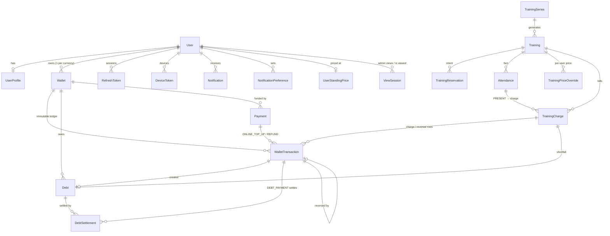

# 03 — Database Design (PostgreSQL + Prisma)

Status: **Draft for approval** · 2026-11-24
Live schema: [`apps/api/prisma/schema.prisma`](../apps/api/prisma/schema.prisma). The Phase 1 proposal is kept in [`archive/`](archive/proposed-schema-phase1.prisma).

---

## 1. Entity overview



| Group | Tables |
|---|---|
| Identity & security | `users`, `user_profiles`, `refresh_tokens`, `password_reset_tokens`, `email_verification_tokens`, `view_sessions` |
| Money | `wallets`, `wallet_transactions` (ledger), `training_charges`, `debts`, `debt_settlements`, `payments`, `stripe_events` |
| Trainings | `training_series`, `trainings`, `user_standing_prices`, `training_price_overrides`, `training_reservations`, `attendances` |
| Notifications | `notifications`, `notification_preferences`, `device_tokens`, `notification_deliveries` |
| Platform | `audit_logs`, `outbox_events`, `idempotency_records`, `app_settings` |

**Mapping to the entities you listed:** `UserProfile`, `Wallet`, `WalletTransaction`, `Training`, `TrainingReservation`, `Attendance`, `TrainingPriceOverride`, `Notification`, `DeviceToken`, `RefreshToken`, `AuditLog` appear as named. **`Payment`** is the Stripe payment attempt. **`Debt`** is per-charge debt, with `DebtSettlement` linking each debt to the ledger rows that paid it. I added `TrainingCharge` (the price snapshot), `StripeEvent`, `ViewSession`, `OutboxEvent`, `IdempotencyRecord`, `AppSetting`, and the optional `TrainingSeries` and `UserStandingPrice` (pending decisions D7 and D5).

---

## 2. Conventions
- **Money** is stored as `Int` in **minor units** (cents), always next to a `currency CHAR(3)`. A 32-bit int allows up to €21.4 M per row, far beyond the configured limits (D14). Aggregates in reports are computed as `bigint` in SQL and converted safely (below 2^53). JavaScript code never uses floats for money: all arithmetic goes through `packages/money`.
- **IDs** are UUIDv7: time-ordered, so B-tree indexes stay compact, and they are not enumerable.
- **Time** is stored as `timestamptz` in UTC. Trainings also store an IANA `timezone` so DST is handled correctly.
- **Naming:** Prisma models are PascalCase. Tables and columns are snake_case via `@@map` / `@map`.
- **Email** is normalized to lower case before writing, with a unique index.

---

## 3. The financial model

### 3.1 One ledger row per financial event, tracking balance and debt
`wallet_transactions` is the **immutable source of truth**. `wallets.balance_minor` and `wallets.debt_minor` are cached projections, changed only in the same locked transaction that inserts the ledger row.

Every row stores:
- `amount_minor`: the gross business amount (always > 0)
- `wallet_delta_minor`, `debt_delta_minor`: the signed effect
- `balance_before/after_minor`, `debt_before/after_minor`: a self-verifying chain
- `sequence`: gap-free per wallet, so tampering or lost rows are detectable
- `idempotency_key` (unique), `group_id` (links a top-up to the debt settlements it triggered)
- links: `training_id`, `training_charge_id`, `payment_id`, `created_by_admin_id`, `reverses_transaction_id`

Spec fields → columns: Transaction ID `id` · User ID `user_id` · Type `type` · Amount `amount_minor` · Currency `currency` · Previous balance `balance_before_minor` · New balance `balance_after_minor` · Payment method `payment_method` · Description `description` · Created `created_at` · Related training `training_id` · Administrator `created_by_admin_id`.
**Status:** ledger rows are only ever written once they are final, so they carry no mutable status column. Pending, failed and refunded states belong to `payments.status`. The API returns a derived `status` of `POSTED` or `REVERSED` (a row is reversed when a row with `reverses_transaction_id` points to it). This keeps the ledger truly append-only.

### 3.2 Delta rules per type
| Type | walletΔ | debtΔ | Rule |
|---|---|---|---|
| `ONLINE_TOP_UP` | +amount | 0 | Only from a verified Stripe webhook. Followed by FIFO debt settlement. |
| `CASH_TOP_UP` | +amount | 0 | Admin only; `created_by_admin_id` required. Followed by FIFO debt settlement. |
| `TRAINING_PAYMENT` | −min(balance, price) | +(price − paid) | `amount = price snapshot`; `−walletΔ + debtΔ = amount`. |
| `DEBT_PAYMENT` | −amount | −amount | Created automatically by settlement. One row per settled debt. |
| `REFUND` | −amount | 0 | Money paid back out (Stripe refund or cash); limited to the available balance. |
| `ADJUSTMENT` | ±amount | 0 or −amount | Admin correction with mandatory reason. A debt waiver is `debtΔ = −amount`. A credit triggers settlement. |
| `REVERSAL` | see §3.4 | see §3.4 | References the original row; each row can be reversed once. |

Invariants checked in code **and** in the database: `balance_after = balance_before + wallet_delta ≥ 0` and `debt_after = debt_before + debt_delta ≥ 0`.

### 3.3 Worked example (the spec's €10 fee / €6 balance case)
| # | Event | Type | Amount | walletΔ | debtΔ | Balance | Debt |
|---|---|---|---|---|---|---|---|
| 1 | Cash payment €6 | CASH_TOP_UP | 600 | +600 | 0 | 0 → 600 | 0 |
| 2 | Present at €10 training | TRAINING_PAYMENT | 1000 | −600 | +400 | 600 → 0 | 0 → 400 |
| 3 | Online top-up €50 | ONLINE_TOP_UP | 5000 | +5000 | 0 | 0 → 5000 | 400 |
| 4 | Auto-settlement (same DB tx as #3) | DEBT_PAYMENT | 400 | −400 | −400 | 5000 → 4600 | 400 → 0 |

After row 2: a `TrainingCharge` (unit price 1000, paid 600, shortfall 400) and a `Debt` (original 400, outstanding 400, OPEN).
After row 4: a `DebtSettlement` (400) and the debt is set to SETTLED.

### 3.4 Reversal semantics
**Reversing a `TRAINING_PAYMENT`** (wrong attendance, or the training was cancelled after finalization) returns everything the user has actually paid towards that charge, and cancels whatever is still owed:
- `walletΔ = paid_at_charge + Σ settlements of its debt`
- `debtΔ = −debt.outstanding`
- The charge becomes REVERSED and the debt becomes CANCELLED.
- Example: reversing row 2 after row 4 gives walletΔ +1000, debtΔ 0. Reversing it before row 3 gives walletΔ +600, debtΔ −400.

**Reversing a top-up** (cash entered by mistake, or a Stripe refund/dispute) takes the amount out of the wallet. If the balance is too low, the remainder becomes a `Debt` with source `TOP_UP_REVERSAL` (pending D18). The balance never goes negative.

**Reversing a reversal** is not allowed. The admin re-posts the correct operation instead.

### 3.5 Debt allocation policy (pending D16, recommended)
For every credit (online/cash top-up, positive adjustment, reversal credit), inside the same transaction:
```
available = wallet.balance_after_credit
for debt in open debts ORDER BY created_at, id:     -- FIFO, oldest first
    pay = min(available, debt.outstanding)
    if pay == 0: break
    insert DEBT_PAYMENT(amount = pay, group_id = credit.group_id)
    insert DebtSettlement(debt, pay); debt.outstanding -= pay; settle if 0
    available -= pay
```
This is a pure function `allocateDebtSettlement(available, openDebts) → settlements[]`, exhaustively unit-tested.

### 3.6 Price resolution and snapshots
`price = TrainingPriceOverride(training, user) ?? UserStandingPrice(user) ?? training.default_price`
The resolved value and its `price_source` are **copied into `training_charges` at finalization**. Later edits to the training price, overrides or standing prices never touch existing charges or ledger rows.

### 3.7 Concurrency and idempotency guarantees
| Threat | Guard |
|---|---|
| Two operations on one wallet at once | `SELECT … FOR UPDATE` on `wallets`; unique `(wallet_id, sequence)` |
| Duplicate webhook | `stripe_events.id` PK; ledger `idempotency_key = 'stripe_pi:<pi_id>'` |
| Double-tap on "Add cash payment" | `Idempotency-Key` header → `idempotency_records`; ledger key `cash:<actor>:<client key>` |
| Finalize clicked twice / by two admins | `trainings` row lock + `attendance_finalized_at` check; partial unique on active charges |
| Same top-up intent created twice | `payments (user_id, client_idempotency_key)` unique; Stripe idempotency key |
| Last capacity spot | `trainings` row lock while counting ATTENDING reservations |
| Deadlocks in multi-wallet operations | Lock wallets in ascending id order |

---

## 4. Indexes (beyond PK/FK)
| Table | Index | Serves |
|---|---|---|
| wallet_transactions | `(user_id, created_at DESC)` | User transaction history |
| wallet_transactions | `(type, created_at)` | Reports (top-ups, cash, revenue per period) |
| wallet_transactions | `(created_by_admin_id, created_at)` | Cash collected per admin |
| wallet_transactions | `(training_id)`, `(group_id)` | Training financials; top-up + settlements |
| debts | `(wallet_id, status, created_at)` | FIFO open-debt scan |
| trainings | `(status, starts_at)`, `(starts_at)` | Upcoming lists, reminders |
| training_reservations | `(training_id, status)` | Capacity count, admin reservation list |
| attendances / charges | `(user_id, created_at)` | Attendance and training history |
| notifications | `(user_id, read_at, created_at DESC)` | Unread badge, feed |
| payments | `(status, created_at)` | Stuck-payment sweeper |
| users / user_profiles | `(role, status)`, `(last_name, first_name)` | Admin search and filter; **trigram GIN** on name and email in raw SQL for fast `ILIKE` search |
| audit_logs | `(entity_type, entity_id)`, `(actor_id, created_at)` | Audit lookups |
| wallet_transactions *(Phase 9)* | `(created_at DESC, sequence DESC)` | Admin ledger list, dashboard activity, period reports |
| payments *(Phase 9)* | `(created_at DESC)` | Admin payments list |
| *every foreign key (Phase 9)* | a leading index | Joins and cascading deletes; the performance test checks that none is missing |

Measured plans and timings: [07 Performance review](07-performance.md).

---

## 5. Soft deletion and retention policy
| Data | Policy |
|---|---|
| `wallet_transactions`, `debt_settlements`, `training_charges`, `debts`, `payments`, `stripe_events`, `audit_logs` | **Never deleted, never soft-deleted.** Retained ≥ 7 years (Dutch fiscal retention). |
| `users` | Soft delete (`deleted_at`) + **PII anonymization** (`anonymized_at`): email → `deleted+<id>@invalid`, names → "Deleted user", phone/avatar removed, tokens and devices revoked. Financial rows still reference the same `user_id`. |
| `trainings`, `training_series` | Status `CANCELLED` is the normal path. `deleted_at` only for drafts with no reservations or charges. |
| `notifications` | User can delete (soft). Hard-purged after 12 months. |
| `refresh_tokens`, reset/verification tokens, `idempotency_records`, processed `outbox_events` | Hard-deleted by cleanup jobs after expiry (these are not financial records). |

---

## 6. Constraints added as raw SQL in migrations
Prisma cannot express these in the schema, so they ship as hand-written SQL in the migration files:

```sql
-- Non-negative balances and debts
ALTER TABLE wallets ADD CONSTRAINT wallets_balance_nonneg CHECK (balance_minor >= 0),
                    ADD CONSTRAINT wallets_debt_nonneg    CHECK (debt_minor >= 0);

-- Ledger row self-consistency
ALTER TABLE wallet_transactions
  ADD CONSTRAINT wt_amount_positive   CHECK (amount_minor > 0),
  ADD CONSTRAINT wt_balance_chain     CHECK (balance_after_minor = balance_before_minor + wallet_delta_minor),
  ADD CONSTRAINT wt_debt_chain        CHECK (debt_after_minor = debt_before_minor + debt_delta_minor),
  ADD CONSTRAINT wt_balance_nonneg    CHECK (balance_after_minor >= 0 AND debt_after_minor >= 0),
  ADD CONSTRAINT wt_reason_required   CHECK (type NOT IN ('ADJUSTMENT','REVERSAL','REFUND') OR reason IS NOT NULL),
  ADD CONSTRAINT wt_admin_for_cash    CHECK (type <> 'CASH_TOP_UP' OR created_by_admin_id IS NOT NULL),
  ADD CONSTRAINT wt_reversal_link     CHECK ((type = 'REVERSAL') = (reverses_transaction_id IS NOT NULL));

-- Ledger immutability (in addition to REVOKE UPDATE, DELETE from the app role)
CREATE FUNCTION forbid_mutation() RETURNS trigger LANGUAGE plpgsql AS $$
BEGIN RAISE EXCEPTION '% on % is not allowed (append-only)', TG_OP, TG_TABLE_NAME; END $$;
CREATE TRIGGER wallet_transactions_immutable BEFORE UPDATE OR DELETE ON wallet_transactions
  FOR EACH ROW EXECUTE FUNCTION forbid_mutation();
CREATE TRIGGER debt_settlements_immutable   BEFORE UPDATE OR DELETE ON debt_settlements
  FOR EACH ROW EXECUTE FUNCTION forbid_mutation();
CREATE TRIGGER audit_logs_immutable         BEFORE UPDATE OR DELETE ON audit_logs
  FOR EACH ROW EXECUTE FUNCTION forbid_mutation();

-- Only one ACTIVE charge per user per training (re-charge allowed after reversal)
CREATE UNIQUE INDEX training_charges_one_active
  ON training_charges (training_id, user_id) WHERE status = 'ACTIVE';

-- Other money/sanity checks
ALTER TABLE debts ADD CONSTRAINT debts_outstanding_range
  CHECK (outstanding_amount_minor >= 0 AND outstanding_amount_minor <= original_amount_minor);
ALTER TABLE training_charges ADD CONSTRAINT charge_split
  CHECK (paid_from_wallet_minor + shortfall_minor = unit_price_minor);
ALTER TABLE trainings ADD CONSTRAINT training_times CHECK (ends_at > starts_at AND reservation_deadline <= starts_at),
                      ADD CONSTRAINT training_price CHECK (default_price_minor >= 0),
                      ADD CONSTRAINT training_capacity CHECK (capacity IS NULL OR capacity > 0);
ALTER TABLE training_price_overrides ADD CONSTRAINT override_price CHECK (price_minor >= 0);

-- Fast admin search
CREATE EXTENSION IF NOT EXISTS pg_trgm;
CREATE INDEX users_email_trgm ON users USING gin (email gin_trgm_ops);
CREATE INDEX profiles_name_trgm ON user_profiles USING gin ((first_name || ' ' || last_name) gin_trgm_ops);
```

**Database roles:** `app_migrator` owns the schema and runs migrations. `app_runtime` (used by the API and worker) has `SELECT, INSERT` on ledger, settlement and audit tables; `UPDATE` only on projection and lifecycle tables (`wallets`, `debts`, `payments`, `training_charges.status`, …); and no `DELETE` on any financial table.

---

## 7. Reconciliation (nightly job, plus on-demand from the admin Settings screen)
1. For each wallet: `balance_minor = Σ wallet_delta_minor` and `debt_minor = Σ debt_delta_minor = Σ debts.outstanding (OPEN)`.
2. For each wallet: the `sequence` values are contiguous, and each row's `balance_before` equals the previous row's `balance_after`.
3. Each `SUCCEEDED` payment has exactly one `ONLINE_TOP_UP` row with an equal amount.
4. Each active charge's `paid + Σ settlements + outstanding = unit_price`.
Any mismatch → Sentry alert plus an admin dashboard banner. It is **never auto-corrected**: a human posts an `ADJUSTMENT` with a reason.

---

## 8. Design decisions log
| # | Decision | Alternatives considered | Reason |
|---|---|---|---|
| DB-1 | Single-entry ledger whose rows carry **both** balance and debt deltas | Full double-entry bookkeeping with system accounts | Meets every spec field directly, is simpler to reason about, and makes every event (including debt creation) one immutable row. Double-entry can be layered on later for accounting export. |
| DB-2 | Debt as its own per-charge table plus settlements | A single debt counter on the wallet | Enables FIFO allocation, "which training do I owe for", and correct reversals of partially settled charges. |
| DB-3 | Cached balances on `wallets`, under a row lock | Compute `SUM()` on every read | O(1) reads for the dashboard. Correctness is guaranteed by the lock, the CHECKs and nightly reconciliation. |
| DB-4 | Pessimistic locking (`FOR UPDATE`) | Optimistic version column plus retries; SERIALIZABLE isolation | Simple and predictable for low per-wallet contention. No retry storms on top-up and settlement chains. |
| DB-5 | No `status` column on ledger rows | A mutable status (PENDING/COMPLETED/REVERSED) | Keeps rows truly immutable. Pending lives on `payments`, reversed is derived. |
| DB-6 | `Int` minor units | `BigInt`, `Decimal` | Exact, no JSON BigInt serialization issues, ample range for per-row values. |
| DB-7 | `preferred_language` as validated text | Postgres enum | Adding a language needs no migration. |
| DB-8 | Wallet unique per `(user, currency)` | One wallet per user | Spec says EUR first, more currencies later. No schema change needed then. |
| DB-9 | Charges are created at **finalization**, from attendance | Charging on each PRESENT mark | Attendance can be edited freely before finalization without generating reversals. |
